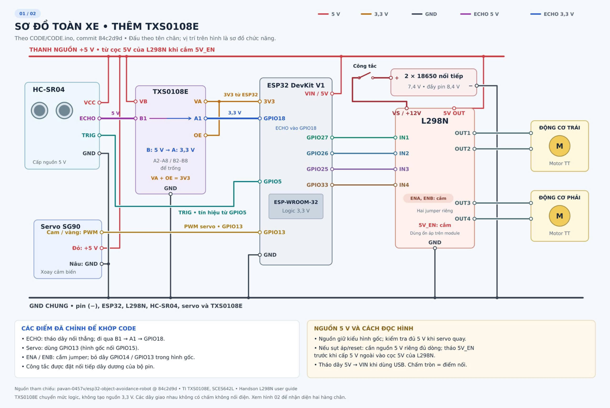

# Xe tự hành tránh vật cản sử dụng ESP32

Đồ án xe tự hành hai bánh chủ động, điều khiển bằng **ESP32 / MicroPython**. Xe sử dụng **HC-SR04** gắn trên **servo SG90** để quét khoảng cách, **L298N** để điều khiển hai động cơ DC và **TXS0108E** để chuyển mức tín hiệu **ECHO 5 V xuống 3,3 V** trước khi đưa về ESP32.


## 1. Danh sách linh kiện

| Linh kiện | Số lượng | Công dụng |
|---|---:|---|
| ESP32 DevKit V1 | 1 | Bộ điều khiển MicroPython |
| HC-SR04 | 1 | Đo khoảng cách vật cản |
| Servo SG90 | 1 | Quay HC-SR04 để quét góc |
| TXS0108E | 1 | Chuyển mức đường ECHO 5 V → 3,3 V |
| L298N | 1 | Điều khiển hai động cơ DC |
| Động cơ giảm tốc TT và bánh xe | 2 bộ | Dẫn động trái / phải |
| Pin 18650 mắc nối tiếp | 2 | Nguồn động cơ, danh định 7,4 V |
| Khay pin, công tắc, khung, dây nối, USB | Theo mô hình | Cấp nguồn và cố định linh kiện |

## 2. Cấu trúc kho mã nguồn

```text
xe-tu-hanh-esp32/
├── README.md
├── xe_tu_hanh_co_ban (3).py    # Mã demo MicroPython gốc
└── docs/
    └── so_do_dau_day.png       # Đấu dây và nguồn theo chân GPIO trong mã
```

**Mã chương trình:** [xe_tu_hanh_co_ban (3).py](./xe_tu_hanh_co_ban%20%283%29.py)  
**Sơ đồ:** [docs/so_do_dau_day.png](./docs/so_do_dau_day.png)


## 3. Đấu nối theo đúng mã nguồn

| ESP32 / linh kiện | Kết nối với | Ghi chú |
|---|---|---|
| GPIO27 | L298N IN1 | Động cơ trái |
| GPIO26 | L298N IN2 | Động cơ trái |
| GPIO25 | L298N IN3 | Động cơ phải |
| GPIO33 | L298N IN4 | Động cơ phải |
| GPIO5 | HC-SR04 TRIG | Tín hiệu kích đo |
| HC-SR04 ECHO | **TXS0108E B1** | Tín hiệu phía **5 V** |
| **TXS0108E A1** | GPIO18 | Tín hiệu phía **3,3 V** |
| GPIO13 | SG90 Signal | PWM servo 50 Hz |
| ESP32 3V3 | TXS0108E VA, OE | Nguồn mức logic A và cho phép hoạt động |
| 5 V đã kiểm tra ổn định | HC-SR04 VCC, SG90 V+, TXS0108E VB | Không nối vào 3V3 |
| GND | ESP32, L298N, HC-SR04, SG90, TXS0108E, nguồn | **Phải nối GND chung** |
| L298N OUT1 / OUT2 | Motor trái | Đổi đầu ra nếu chiều quay thực tế sai |
| L298N OUT3 / OUT4 | Motor phải | Đổi đầu ra nếu chiều quay thực tế sai |

**Điều khiển L298N:** Mã hiện tại giữ jumper **ENA/ENB** và tạo PWM tại **IN1–IN4**, không dùng PWM trực tiếp ở ENA/ENB. Hãy giữ cấu hình này nếu không sửa mã.

**Nguồn cấp:** Bộ pin 2 × 18650 mắc nối tiếp có điện áp danh định 7,4 V (có thể tới 8,4 V lúc đầy), qua công tắc cấp vào **VS/+12V** và GND của L298N. Với một số module L298N, chân 5 V chỉ là **đầu ra** khi cắm 5V_EN và bộ ổn áp đủ điều kiện hoạt động. Phải **đo điện áp 5 V khi có tải**, đặc biệt lúc servo và motor chạy; nếu không ổn định, dùng nguồn 5 V ổn áp riêng đủ dòng và đấu đúng cấu hình module. **Không đưa trực tiếp 7,4–8,4 V vào chân 5V hoặc 3V3 của ESP32.** Khi ESP32 cắm USB máy tính, tháo dây cấp 5 V từ bên ngoài vào VIN/5V của ESP32 để tránh cấp chéo; vẫn dùng GND chung. Kiểm tra sơ đồ chân của đúng board và nguồn thực tế trước khi cấp điện.

## 4. Nguyên lý tránh vật cản

1. Khi chạy, xe dừng và đếm lùi **3 giây**, sau đó quét trước khi di chuyển.
2. HC-SR04 trên SG90 quét trong vùng **30°–150°**, mỗi bước **15°**; mỗi vị trí vừa tới được đo một lần. Thời gian chờ sau bước servo là **70 ms**.
3. Xe chỉ tiến khi các kết quả trong vùng trước **75°, 90°, 105°** đều **lớn hơn 30 cm**. Mỗi lần quét giữ xe dừng ít nhất **1 giây**.
4. Khi đi thẳng, servo nhìn ở **90°**; nếu khoảng cách đo được **≤ 30 cm**, xe dừng.
5. Nếu vùng phía trước bị chắn, hai bánh quay ngược chiều để **quay phải** rồi dừng và quét lại; lặp đến khi vùng trước đủ thoáng. Chương trình **không** chọn hướng bằng cách so sánh bên trái/bên phải.
6. Nếu ECHO lỗi/timeout hoặc nhận **Ctrl+C**, chương trình dừng động cơ và kết thúc.

### Thông số trong mã

| Tham số | Giá trị | Ý nghĩa |
|---|---:|---|
| `STOP_DISTANCE_CM` | `30` | Ngưỡng dừng, đơn vị cm |
| `FORWARD_PERCENT` | `60` | Duty PWM khi tiến, không phải vận tốc thực |
| `TURN_PERCENT` | `50` | Duty PWM khi quay phải |
| `MOTOR_PWM_HZ` | `1000` | Tần số PWM động cơ |
| `TURN_45_MS` | `150` | Thời gian quay phải ban đầu, chưa đảm bảo đúng 45° |
| `SCAN_MIN_ANGLE` / `SCAN_MAX_ANGLE` | `30` / `150` | Biên quét |
| `SCAN_STEP_DEG` | `15` | Bước góc |
| `SERVO_STEP_MS` | `70` | Chờ mỗi bước servo |
| `MIN_SCAN_MS` | `1000` | Thời gian dừng tối thiểu mỗi lượt quét |
| `PING_INTERVAL_MS` | `65` | Giãn cách kích siêu âm tối thiểu |

`TURN_45_MS` là một ước lượng theo **thời gian**, không đo góc quay bằng encoder hay IMU. Cần hiệu chỉnh theo pin, độ bám sàn và tải xe. Nếu hai bánh lệch tốc độ, hiệu chỉnh `LEFT_TRIM`, `RIGHT_TRIM`; nếu bánh quay ngược, kiểm tra `INVERT_LEFT`, `INVERT_RIGHT`.

## 6. Chạy chương trình bằng Thonny

1. Cài **Thonny**, cài firmware **MicroPython dành cho ESP32** nếu board chưa có.
2. Đấu nối theo sơ đồ; trước lần thử đầu **nâng hai bánh khỏi mặt bàn** và kiểm tra nguồn bằng đồng hồ đo. Giữ công tắc động cơ OFF trong lúc kiểm tra kết nối.
3. Cắm ESP32 bằng cáp USB dữ liệu. Trong Thonny, chọn **Tools → Options → Interpreter → MicroPython (ESP32)** và đúng cổng COM.
4. Mở tệp **`xe_tu_hanh_co_ban (3).py`**, nhấn **F5** để chạy thử. Quan sát **Shell** và kiểm tra chiều quay bánh, servo và khoảng cách in ra.
5. Nếu xe chạy sai chiều, ngắt nguồn động cơ rồi sửa `INVERT_LEFT` / `INVERT_RIGHT`, sau đó thử lại. Hiệu chỉnh `LEFT_TRIM`, `RIGHT_TRIM`, `TURN_45_MS` nếu cần.
6. Dừng bằng **Ctrl+C**. Sau khi xe hoạt động đúng trên phần cứng, trong Thonny chọn **File → Save as → MicroPython device**, lưu tên **`main.py`** để tự chạy lúc ESP32 khởi động độc lập.

**Lưu ý:** File `main.py` không được đưa sẵn vào kho để tránh vô tình tự chạy trước khi đấu nối/hiệu chỉnh đúng. Đừng lưu thành `main.py` khi chưa thử an toàn trên xe thật.


## 7. Tài liệu tham khảo

- [Tài liệu API MicroPython — `machine.PWM`](https://docs.micropython.org/en/latest/library/machine.PWM.html)
- [HC-SR04 Ultrasonic Sensor datasheet](https://cdn.sparkfun.com/datasheets/Sensors/Proximity/HCSR04.pdf)

---

